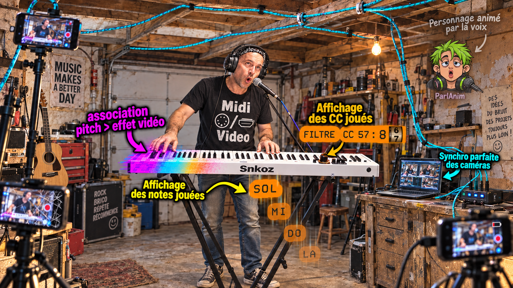

# Snkoz - vidéo, audio et effets pilotés par MIDI

Enregistrer plusieurs sources, monter en temps musical et relier notes, vélocité, CC ou voix aux effets vidéo et aux animations.

[Voir la vidéo YouTube](https://youtu.be/prQQBhpKYqU) · [Soutenir le projet sur Ko-fi](https://ko-fi.com/ers115)

## 1. Télécharger Snkoz Windows R21

**VA01.15 R21 - Windows 10.1.15.20 - prototype / préversion.**

[Téléchargements de la R21](https://github.com/da23real/Snkoz/releases/tag/windows-VA01.15-R21)

- `Snkoz-VA01.15-R21-Windows.zip` : application Windows, guides et deux PDF.
- `Snkoz_R21_Conception_avec_IA.pdf` : diagnostics concrets, simulations et choix des paramètres usuels ou avancés.
- `Snkoz_R21_Nouveautes_et_corrections.pdf` : nouveautés R21, historique de la série et limites connues.
- `SHA256SUMS.txt` : empreintes des téléchargements.

**FFmpeg et les autres dépendances externes ne sont pas inclus.** Suivre [Installation FR](Documentation/Installation/README_FR.md) ou [Installation EN](Documentation/Installation/README.md), puis [les dépendances](DEPENDENCIES.md).

## 2. Notes, CC et voix au service de l’image

- Afficher les notes jouées et les valeurs des contrôleurs MIDI ; régler correspondances, inversions et enveloppes.
- Déclencher et moduler les effets, sélectionner les images et les banques d’animation.
- Utiliser les données issues de l’analyse vocale pour piloter les animations ; presets génériques avec images choisies par l’utilisateur.
- Enregistrer une passe de CC sur une piste indépendante, avec preview ou écoute audio seule.
- Stabiliser les changements de source et ignorer le souffle faible avec des réglages distincts.
- Choisir les paramètres MIDI visibles, réordonner les traitements audio, couper séparément son et image et lire directement les sources.

[Guide R21](Documentation/Usage/README_FR.md) · [Changements](CHANGELOG.md) · [Version et validation](VERSION.md)

**Compatibilité :** R21 lit les projets 100218 à 100232 et écrit 100232. R20 ne lit pas les nouvelles écritures R21. Les projets antérieurs à 100218 ne sont pas convertis par ce paquet.

## 3. Conception avec l’IA

[Lire le dossier illustré](Documentation/R21/Snkoz_R21_Conception_avec_IA.pdf) : 8 111 CC filtrés à tort, essais de lisibilité du texte, impulsions trop courtes pour une vidéo à 30 images/s, banques vocales et bugs intermittents. Les simulations servent à choisir des réglages utiles, en distinguant ce qui est livré des points ouverts.

[Lire les nouveautés et corrections](Documentation/R21/Snkoz_R21_Nouveautes_et_corrections.pdf).

## 4. Sources et périmètre

[Sources Windows R21](Windows) · [Compilation](BUILDING.md) · [Contribuer](CONTRIBUTING.md)

Ce dépôt contient l’application PC et les sources historiques de son compagnon caméra Android. **Aucun code de séquenceur, firmware Arduino/Teensy/Pico, clé de signature ou enregistrement personnel n’est publié.** Les références matérielles du client PC ne sont pas des firmwares. Le convertisseur privé des projets du séquenceur est exclu ; sa commande n’est pas disponible dans ce paquet autonome.

Android conserve sa [release séparée VA01.16 R25](https://github.com/da23real/Snkoz/releases/tag/android-VA01.16-R25). Les sources Android présentes sur `main` sont celles d’A01, pas celles de cet APK R25. R21 ne remplace ni l’APK ni ces sources historiques.

## 5. Licence

Snkoz est gratuit à utiliser, y compris pour un travail professionnel. Vous pouvez publier, monétiser et vendre les vidéos produites, sans redevance Snkoz, avec les droits nécessaires sur vos médias.

Les sources sont consultables et modifiables pour votre usage privé et pour contribuer ici. Les forks nécessaires aux contributions sont autorisés. Les distributions indépendantes, la revente et les miroirs du logiciel nécessitent un accord écrit. Les dépendances conservent leurs licences. La licence spécifique **source-available** existante reste inchangée : [LICENSE](LICENSE).

## 6. English

Snkoz connects video/audio to musical timing and MIDI-driven effects. Windows VA01.15 R21 (10.1.15.20) is a prerelease with modular effects, note/CC text, animation banks, independent CC recording passes, audio/video mutes and direct source playback.

[Watch the demonstration](https://youtu.be/prQQBhpKYqU), [download R21](https://github.com/da23real/Snkoz/releases/tag/windows-VA01.15-R21), then follow the [installation guide](Documentation/Installation/README.md). External dependencies are required. The French PDFs document AI-assisted development and the change history. No sequencer firmware is included. New R21 files cannot be opened by R20. See [VERSION.md](VERSION.md) for limits.
